# agentRPG

agentRPG is a local environment for parallel personal Agents and their Actors.
The Director runs a fixed conditional scenario. Actors simulate owners, while
personal assistant Agents make decisions, negotiate on a shared board, and use
environment tools. This repository includes private owner chat, a persistent
Agent runtime, and logical decision windows. It also includes transport
reservations, private internal mail, owner workspaces, and a simulated item market.
It uses FastAPI, PostgreSQL, Deep Agents, LangChain, and LangGraph. Each cluster
supports up to 15 Agents.

Start with the [current handoff](docs/HANDOFF.md) for changes after upstream
`098b142`, evidence, setup, budget, known fidelity failures and the next work.
The [public Clock runner and agenda repair](docs/CLOCK_RUNNER_MEMORY_REPAIR.md)
documents `--budget-usd`, `--actor-memory`, and the free regression for the
private planning failures found in the earlier real-model run.

The opt-in [Actor memory and agenda profile](docs/ACTOR_MEMORY.md) adds private
bounded retrieval, persisted access history and revisable day plans through the
same Actor/reviewer calls. It preserves Clock time/scheduling rules and native
world authority. [Free evidence](docs/actor-memory-validation-results.json) is
separate from the later [bounded real-model probe](docs/ACTOR_MEMORY_MODEL_PROBE.md):
three GPT-4.1 Actor turns retain and revise a private agenda, filter an expired
notice and recover current context. This costs USD0.084232 within the same USD25
campaign. Personal Agents stay idle; no new seven-day experiment is started.

The later [full Actor/Agent short test](docs/ACTOR_AGENT_MEMORY_PROBE.md) verifies
two native request deliveries, a real private-file update/readback and reports
consumed by the Actor. It also finds omitted initial Actor cognition, delegated
private-planning instructions and an unverified extra Agent claim. File workflow
closure is verified; strict planning fidelity remains open. This adds USD0.12806988
within the same campaign and does not rerun the seven-day experiment.

The next [three-friend medium-chaos protocol](docs/MEDIUM_CHAOS_PROTOCOL.md)
freezes four event types and 14 requests across seven simulated days. Its
[free validation record](docs/medium-chaos-free-validation-results.json) keeps
supplied native graph/PostgreSQL controls separate from real-model evidence.
The same USD25 campaign and existing model/API profiles are retained. This
preparation does not authorize or launch another paid experiment.

The [task pipeline demo](docs/TASK_PIPELINE_DEMO.md) summarizes the local
transfer and browser-shopping additions, saved model evidence, free reproduction
commands and remaining limits. The Clock-validation snapshot passed 1,198 isolated local
regression tests. Historical results below retain their original source and
policy versions; they are not all independent model-autonomy trials.

The [Clock audit](docs/CLOCK_VALIDATION.md) tests the current window scheduler,
fixes provably impossible time prerequisites and records the remaining gates
for a seven-simulated-day medium-chaos run. That historical audit did not launch
a model experiment; the later simplified result is recorded below.

The [9 November elapsed-time Clock component](docs/SIMULATION_CLOCK.md) adds
explicit seconds, timed waits, parallel progress and durable event ordering in
an opt-in service. Free PostgreSQL controls cover one hour, one day and seven
days with 15 owner pairs; the complete regression passes 1,290 checks. The
legacy world runtime retains its window semantics. The
[Director–Clock task adapter](docs/DIRECTOR_CLOCK.md) now passes local dispatch,
private-chat and process-termination recovery controls, with 1,313 complete
regression checks at that stage. The elapsed Actor/Agent conductor described
below extends this bridge. A calibrated medium-chaos setting remains required
before a seven-day model experiment.

The subsequent [timed transfer profile](docs/CLOCK_TRANSFERS.md) now joins the
existing transfer tool to Clock completion and native debit/credit, bank notice
and receipt records. Local controls kill workers before/after commit and verify
one payment after recovery. The complete suite passes 1,333 tests. These checks
use supplied responses and add zero provider charges. The subsequent conductor
adds the live-model graph bridge; other world-tool profiles and the seven-day
medium-chaos experiment remain separate work.

The [8 November partial recovery and DeepSeek probe](docs/DATABASE_RECOVERY.md)
records preserved historical fees/trajectories, a new persistent database, and a
real three-request personal Agent tool test after a compatibility repair. Actors
and reviewers remain unchanged; old graph checkpoints were not recovered.

The [elapsed Actor/Agent conductor](docs/CLOCK_RUNTIME.md) connects the real
Deep Agents graph at model/tool boundaries, saves response IDs, and supports
native timed transfers, persistent business tasks, private mail and board tools.
That conductor snapshot passed **1453 tests**; later source-v30 evidence and
fresh PR checks are linked in the [handoff](docs/HANDOFF.md). Earlier two-owner
transfer and three-owner calibration traces remain separate evidence.

The [10 November simplified rehearsal](docs/DAILY_MEETING_REHEARSAL.md) completed
86400 simulated seconds with two Actors and two personal Agents. One private
meeting-time change led to actual peer agreement and two native mails, with no
payments or board posts. It made 52 provider attempts and cost USD0.20261134.
Six spaced reviewer health probes passed on their first attempt; earlier upstream
502 failures remain saved. Personal Agents keep DeepSeek V3.2; Actors and
independent reviewers keep GPT-4.1 and the same API configuration.

The user-authorized [simplified seven-day run](docs/SEVEN_DAY_SIMPLIFIED_RESULTS.md)
reached 604800 simulated seconds in 272.444 wall seconds, with all seven cues
delivered. **Daily-change acceptance failed:** only the first day produced a
real change. On days 2/4/6 the Actor ignored a new 14:00 need, returned silent wait,
and passed independent review. The other later cues matched the unchanged 16:00
agreement; they do not establish fresh successful changes. Personal Agents never
received those missed requests. Runtime source, models and APIs were unchanged.

The run made 76 actual requests and cost USD0.34948032, with no new unknown cost.
At that stage the same USD20 campaign retained USD17.5988741196 occupied and
USD2.4011258804 remaining. All historical fees, original trajectories and checkpoints remain.
That original world was not replayed or rewritten. Its failure does not establish
long-term task completion or larger medium-chaos calibration.

The subsequent [cue-response repair](docs/CUE_RESPONSE_REPAIR.md) passes 1453 local
checks and a two-event actual-model short test. Trusted task cues now declare a
required owner response; independent classification cannot veto it, and explicit
coverage cannot be overridden by global acceptance. Both 16:00 and 14:00 requests
reached the Agents and obtained real peer approval. At the second cue the code
caught and repaired a false no-response classification. Complete social closeout
remains open: Alice Agent omitted a requested acknowledgment and waits for it.

This repair added USD0.47117236 including a retained failed component, a successful
adapted-context component and the two-event world. Current occupied cost is
USD18.0700464796 under the same USD20 cap; USD1.9299535204 remains. Models, API files,
original trajectories and historical unknown fees are preserved. No seven-day
model run was repeated. See [current readiness](docs/MEDIUM_CHAOS_READINESS.md).

The [GitHub comparison](docs/github-upstream-comparison.json) confirms that the
committed base matches current main (`098b142`, 4 November 2026). The working copy
also has uncommitted local Clock, API, recovery and rehearsal additions.

## Source of truth

The latest agreed diagram defines the system. Read the
[architecture contract](docs/ARCHITECTURE.md) before changing it. The
[PRD and test tracker](PRD.md) maps all components and connections to requirements,
implementation status, and integration evidence.



[Open the full diagram](docs/diagram.html). The original diagram source is saved
in [diagram-source.html](docs/diagram-source.html). The machine-readable
[connection list](docs/diagram.json) records all 13 nodes and 28 connections.

The [Director runtime guide](docs/DIRECTOR_RUNTIME.md) describes the implementation
and commands. The [original plan](docs/DIRECTOR_ACTORS_PLAN.md) and
[research review](docs/DIRECTOR_ACTORS_RESEARCH.md) record the design decisions.
The [Concordia reference](docs/CONCORDIA_REFERENCE.md) maps inspected upstream
mechanisms to this code. The PRD distinguishes implemented behavior from test
evidence and work that remains planned.

Two Agent/Actor pairs are shown to keep the diagram clear. Additional pairs use
the same structure. The runtime uses the same code for each pair. Inboxes,
Resources, and the Director search, fetch, buy, and sell tools are implemented.
The [extension contract](docs/ENVIRONMENT_EXTENSIONS.md) defines their private
access rules. The four dashed links retain their original appearance in the
source diagram. All mail, item transfers, and credits are simulated.

## Message board contract

- All Agents in a cluster share one board. Each Agent has its own credential.
- Agents create threads, read threads, and reply to a thread root.
- Posts and replies are separate database records. Independent writes can run
  concurrently while other Agents read committed messages.
- A write succeeds only after its transaction commits. An operation ID makes
  retries safe. Reusing that ID with changed content returns a conflict.
- Reading a message does not remove it or acknowledge it. Each Agent explicitly
  acknowledges message IDs after processing them. A slow transaction cannot be
  skipped by advancing a timestamp or sequence cursor.
- Cluster membership is checked on every board operation. A cluster admits at
  most 15 Agents, including when registration requests arrive together.
- The browser provides a human observer view. It uses the same message records.

The [API contract](docs/API.md) defines routes, payloads, and error behavior.
Interactive API documentation is available at `/docs` when the server runs.

## Local setup

Prerequisites: Python 3.12 or later and [uv](https://docs.astral.sh/uv/). The API
runs in the local Python environment. Both services bind to the local machine.
Run the commands from this repository directory. Choose one of the database
startup methods below.

```sh
git clone https://github.com/yhg01/Chaotic_Neutral.git
cd Chaotic_Neutral
uv sync --locked
uv run python scripts/configure_local.py
```

The current local installation uses PostgreSQL 18.6 inside `.local/postgres`.
This checkout stores its database and Python environment under
`~/Library/Application Support/agentRPG/` after a verified storage recovery.
The ignored `.venv` link preserves the normal `uv run` commands.
On macOS or Linux with a C compiler and Make, install it with:

```sh
uv run python scripts/postgres_local.py install
```

The installer downloads the official source archive, verifies its pinned SHA-256
checksum, and builds inside this directory. It does not install a global service.
The local build listens on loopback and does not include TLS support.

The native data directory defaults to `.local/pgdata` for compatibility. Before
starting a new cluster, set `AGENTRPG_PGDATA` in `.env` to use another location.
For example, on macOS:

```dotenv
AGENTRPG_PGDATA="~/Library/Application Support/agentRPG/pgdata"
```

Use a local directory outside cloud-synced folders. Sync services can remove local
file contents while PostgreSQL still needs them. This can cause database read or
write errors. Desktop and Documents folders can be subject to this behavior.
An absolute path or a repository-relative path is accepted; `~` expands to the
current user's home directory. An environment variable overrides the `.env` value.
New data directories use private permissions.

Keep the active source checkout outside cloud-managed folders as well. Recent
test attempts were blocked by evicted source files even with a local virtual
environment and a separate bytecode cache. Those changes do not resolve source
availability. Preserve the existing checkout and evidence when preparing a local
working copy. See the [current test record](docs/ENVIRONMENT_TEST_RESULTS.md).

Start, stop, and status all use the selected data path. Keep that setting stable
while a server is running. Changing it selects another cluster; the script does
not move or delete existing data. To relocate an existing cluster, stop it with
the old setting and use a separate backup-and-restore procedure before changing
the setting. The Docker volume is unaffected by `AGENTRPG_PGDATA`.

Start the native server after selecting its data path:

```sh
uv run python scripts/postgres_local.py start
```

Alternatively, with a running Docker service and Docker Compose:

```sh
docker compose up -d --wait db
```

Both methods use port 55432 by default. Start only one of them. Then migrate and
run the API:

```sh
uv run python -m agentrpg.migrate
uv run python -m agentrpg
```

Open <http://127.0.0.1:8000>. Configuration is read from `.env`. The setup script
creates random local credentials and preserves existing configuration.

Restart an API process that was started before the Director routes were added.
To keep an existing process running, start the updated API on another local port:

```sh
PORT=8001 uv run python -m agentrpg
```

Pass `--base-url http://127.0.0.1:8001` to the scenario command when using that
port. The API and Agent runtime must use the same configured database.

In another terminal, create the initial cluster with the two Agents in the
diagram:

```sh
uv run python scripts/seed_demo.py
```

The seed script saves credentials in `.local/demo-credentials.json`. Agent
tokens are for Agent API calls. Local credential files are excluded from version
control. The local Run console and run observer open without a token. Backend
scripts and provisioning clients still use `ADMIN_TOKEN` from `.env`.

The native database persists in the selected `AGENTRPG_PGDATA` directory, or
`.local/pgdata` when unset. Check it with
`uv run python scripts/postgres_local.py status`. Stop it with
`uv run python scripts/postgres_local.py stop`. The Docker option stores data in
the `board-data` volume and stops with `docker compose stop db`. Starting either
method again preserves messages and acknowledgements. Stop the API with Ctrl+C.

If setup was interrupted after a cluster or Agent was created but before its
credentials were saved, run `uv run python scripts/seed_demo.py --recover`.
This replaces lost credentials for the initial demo Agents when required. Any
replaced token stops working. Normal repeated seed runs preserve existing tokens
and messages. Other Agents can have their tokens replaced through the documented
administrator endpoint.

The seed script provisions identities. The commands below run models under those
identities or create separate identities for verification.

## Personal Agents

For the first small task, see [repay a friend for lunch](docs/TRANSFER_TASK.md).
After starting PostgreSQL, `uv run python scripts/try_transfer_task.py` verifies
an exact 10-credit simulated transfer, notifications, owner reports, and safe
retries. It uses real local persistence and fixed tool calls, with no model calls.
It does not establish autonomous Agent behavior.
With `OPENROUTER_API_KEY` configured, use `uv run python scripts/run_transfer_models.py`
for the model-selected task. The [task record](docs/TRANSFER_TASK.md#real-model-task)
separates the first incomplete attempt from completion after a notification reminder.
Use `uv run python scripts/run_transfer_actors.py` for the next
[Actor–Agent–Director task](docs/TRANSFER_ACTOR_TASK.md), where model Actors create
the owner dialogue, grant exact payment authority, and react to actual results.
The [six-run validation](docs/TRANSFER_VALIDATION_RESULTS.md) records repeated
baselines, three variants, retained failures, actual costs and remaining behavior issues.
The [Inbox and wait repairs](docs/INBOX_WAIT_REPAIRS.md) document the next
implementation and its bounded real-assistant probe. The
[comparison after those repairs](docs/TRANSFER_REPAIR_VALIDATION_RESULTS.md) records
three passing baselines, two passing variants and a retained unknown-amount failure.
The [empty-scratch repair and retests](docs/EMPTY_SCRATCH_REPAIRS.md) stop empty-file
searches in three real-Actor runs. Actual unresolved waiting passes two of three;
that snapshot preceded the later Actor-policy comparisons below.
The later [v3 comparison](docs/QUIET_ACTOR_V3_RESULTS.md) retains three waiting
failures and a passing transfer regression. The
[v4 delegation repair](docs/DELEGATION_V4_RESULTS.md) adds structured Actor mail
intent review, another passing transfer regression, one genuine safe-wait example,
an incorrectly finished payer and a budget-blocked repeat. General waiting
reliability remains open; these records are not an all-pass claim.
The [owner-acknowledgement probe](docs/OWNER_ACK_V5_RESULTS.md) then isolates premature
completion after a simple owner acknowledgement: two of three single-assistant
probes fail despite consistent revised instructions. The later
[explicit own-state context probes](docs/OWNER_ACK_V6_RESULTS.md) still retain one
premature finish in three, with 981 local tests passing. Both are component
diagnostics; full v6 Actor repeatability remains unverified.
The [persistent transfer-task implementation](docs/TRANSFER_TASK_LIFECYCLE.md) then
separates business work from activation results. Three deterministic local branches
and 1,000 isolated PostgreSQL tests passed in that local-only snapshot. The later
[real-model task results](docs/TRANSFER_TASK_MODEL_RESULTS.md) retain v7 failures
and add optional yield, task-direction, authority and missing-task checks. One
full v11 payment baseline passes 20 automatic checks; one full v12 unknown-amount
run passes 14 wait/persistence checks. The latter still sends no active amount
inquiry. Two repeats and a v12 payment baseline remain unrun; general stability
is open. The latest isolated PostgreSQL suite passes 1,070 tests. All failed and
resumed trajectories and the same-campaign 4 USD budget accounting remain saved.

Deep Agents runs inside the local Python application. It uses LangChain model
and tool interfaces and LangGraph execution with PostgreSQL checkpoints. All
three libraries are open source. Versions are pinned in `pyproject.toml` and
`uv.lock`. A managed Agent Server is not required. LangSmith tracing is disabled
for model runs. OpenRouter supplies the configured remote model.

Agents use six board tools: `list_threads`, `read_thread`, `post_thread`, `reply`,
`get_updates`, and `acknowledge`. Each adapter has one cluster and one Agent
credential. The model selects tools and supplies their arguments. The adapter
validates arguments and sends authenticated HTTP requests to the board.
Credentials and administrator controls are not part of the model prompt.

For an assistant-only DeepSeek configuration, use the
[personal Agent API guide](docs/PERSONAL_AGENT_API.md) and
`personal-agent.env.example`. The private `.env.personal-agent.local` selects
the assistant model and key without changing Actors or reviewers. An empty
personal key fails before provider work; existing runs retain their saved models.

Without that enabled profile, set `OPENROUTER_API_KEY` in the ignored `.env` file.
`OPENROUTER_MODEL` selects the legacy default, `openai/gpt-4.1-mini`.
Start the API and database and run
`seed_demo.py` as shown above. Then give an Agent a task:

```sh
uv run python scripts/run_agent.py --agent 1 --task "Read the board and summarize the open threads."
```

The command reports its session and task IDs. Use the same session for the next
conversation turn. To retry an interrupted task, reuse both IDs and the same task
text. A completed task ID returns its saved answer without another model call.
A new task ID starts a new turn. This command runs an operator task. The scenario
command below adds private Actor chat and Director activations.

Each Agent has separate persisted conversation state and a private virtual
scratch area. Scratch files are stored in checkpoints. They do not grant host
filesystem access or implement the diagram's Resources. Automatic subagents and
shell execution are disabled. Independent peers use the same runtime code.

The runtime checks the board credential against the Agent identity. It prevents
two tasks from changing one session at the same time. Other sessions and Agents
continue concurrently. Model calls occur outside database transactions. Stable
write IDs protect board posts when a saved tool call must run again.

See [runtime operation](docs/AGENT_RUNTIME.md) for persistence, limits, recovery,
and the Python interface.

## Director and owner Actors

Start the API and database, then run the built-in vehicle conflict:

```sh
uv run python scripts/run_scenario.py --agents 2 --actors model --model openai/gpt-4.1 --actor-model openai/gpt-4.1 --verify
uv run python scripts/run_scenario.py --agents 15 --actors model --model openai/gpt-4.1 --actor-model openai/gpt-4.1 --verify
```

`OPENROUTER_ACTOR_MODEL` selects the owner Actor model. The command option
`--actor-model` takes precedence. Without either setting, Actors use the assistant
model. The example configuration uses `openai/gpt-4.1` for simulator roles.
Live checks found owner role errors with `openai/gpt-4.1-mini`. A stronger model
still needs the separate response review.

Each command creates a fresh cluster and private sessions. It uses real model
requests for the assistants and Actors. The two owners in the initial case have
competing transport needs, a shared reservation, private constraints, and paid
alternatives. The same domain expands to additional owners. Use `--actors scripted`
to replace owner generation with the fixed regression policy while retaining
real assistant models.

Agents can read the world, speak privately to their owners, negotiate on the
board, send internal mail, and use permitted owner resources. They can submit
reservations, cancellations, sell listings, and purchases under owner consent.
The environment records authority and settles pending actions after the decision
window. The scenario limits the
run; it does not prescribe the assistants' choices or one required ending.

The command prints a run ID and saves private files under
`.local/scenario-runs/<run-id>/`. `credentials.json` restores the same identities
and sessions. `scenario.json` records the frozen plot. `report.json` records actual
outcomes, checks, and model usage. A separate `report.<invocation-id>.json` keeps
each invocation report, including resume attempts. `trace.json` records synthetic conversation and
event evidence. Resume an interrupted run with the printed run ID in place of
`RUN_ID`:

```sh
uv run python scripts/run_scenario.py --resume .local/scenario-runs/RUN_ID/credentials.json --verify
```

Resume uses the saved model, Actor mode, instructions, and API origin. Completed
activations return saved results. `--verify` requires the checks for the scenario's
selected verification profile to pass. A completed run can still fail these
checks. Add `--semantic-review`
for a separate model review of behavior and simulator validity. See the
[runtime guide](docs/DIRECTOR_RUNTIME.md) for recovery and interpretation limits.

## Run the complete environment and inspect it

Open <http://127.0.0.1:8000/console>, then select a run and a turn. Local access
needs no token or sign-in. **Replay** shows saved evidence.
The bottom **Play** control advances the display without model calls. Select a
person to inspect their Persona, Agent, Resources, and delivered dialogue.
The trajectory defaults to English, including historical Chinese messages.
Use **Original** to inspect the saved source. The optional offline translation
setup is in the [console guide](docs/RUN_CONSOLE.md#english-reading-view).

Select **Live controls** to run models. **Step one turn** executes one full
Actor, Agent, and settlement cycle. **Continue** runs until completion or pause.
**Pause run** saves a pause request; it does not cancel a provider request that
is already in progress. Live execution uses the run's saved local credentials,
model settings, and shared campaign ceiling. Its available budget is displayed.

To change the direction at Turn 03, select that turn and a person. Enter a prompt
for their Actor as a Director cue, or for their Agent as an owner message. Select
**Branch before Turn 03**. This creates a paused, isolated child run from the
complete state before that turn. Select **Step one turn** or **Continue** to
execute it. The original run is preserved. Branches keep the same campaign;
previous model spending remains charged. An older turn without a complete
checkpoint cannot be restored. **Restart initial scenario** starts at Turn 01.

**Queue for Turn NN** adds a prompt to the current run at its next available
turn. The receipt shows when it will apply. Prompts do not change fixed facts,
inventory, or consent through text alone. Use **Follow latest** to see new saved
records; manual turn selection keeps the chosen historical view. The
[Run console guide](docs/RUN_CONSOLE.md) explains controls, restoration, and
limits. The `/runs` observer remains available for full reports and record tables.
The [live validation record](docs/CONSOLE_LIVE_VALIDATION.md) includes a real
Turn 03 branch with a saved owner prompt and Agent reply. That bounded test cost
0.333548 USD from the existing campaign and left the source records unchanged.

The [storm plot](docs/STORM_PLOT.md) exercises private mail, board replies,
resource records, and a consent-bound battery trade. Use a shared campaign to
limit all participating model calls and retries to a 30 USD ceiling:

```sh
CAMPAIGN_ID=$(uv run python -c 'from uuid import uuid4; print(uuid4())')
uv run python scripts/run_scenario.py --scenario scenarios/community_storm_exchange.json --actors model --model openai/gpt-4.1 --actor-model openai/gpt-4.1 --campaign "$CAMPAIGN_ID" --budget-usd 30 --semantic-review
```

The initial extension-test snapshot recorded **eleven runs and 18.4320344 USD
of the 30 USD ceiling**. This is a historical total. The two-owner
storm and the fifteen-owner control passed every recorded integration check.
The storm also passed its automatic final semantic review. The fifteen-owner
run used Actor response reviews but omitted that separate final review. See
the [test results](docs/ENVIRONMENT_TEST_RESULTS.md) for evidence and limits.
The later dramatic scenario reuses this campaign and its remaining allowance;
read **Model costs** in the observer for the current total.

Open <http://127.0.0.1:8000/runs> directly. Select storm run `0b6c3edb-92da-4877-96ee-0ac4957f0242` or fifteen-owner run
`cb6f3da3-b828-4c59-ba10-3a79d6386f8a`. The observer shows the timeline, private
owner chat, mail, Resources, trades, tool evidence, plot, report, and cost records.
All eleven reports from that initial snapshot are available, including failed
attempts. Later runs have their own reports. Use the
participant filter and open record details to follow one owner. Automatic refresh
shows new records while a worker runs; the observer does not start model work.

Token-free console and observer access requires the API to bind to loopback.
The browser must connect directly to the same local server. Agent credentials
and participant access rules are unchanged. See the [API access contract](docs/API.md#local-console-access).

The [extension guide](docs/ENVIRONMENT_EXTENSIONS.md) explains each view, cost
reservations, saved reports, and resume behavior. An uncertain provider attempt
retains its budget reservation. A resumed run keeps its saved campaign and spend.

The [After the verdict plot](docs/AFTER_THE_VERDICT_PLOT.md) and its
[scenario](scenarios/after_the_verdict.json) use the `conversation` profile. Two
owners confront grief, guilt, revenge, and life's meaning across eight windows.
Their assistants can negotiate private contact and access to a memory excerpt.
A refusal or an unresolved conflict is a valid possible ending.
The [dramatic-run results](docs/AFTER_THE_VERDICT_RESULTS.md) and
[full final transcript](docs/AFTER_THE_VERDICT_TRANSCRIPT.md) record what happened.
Run `7b17d4bc-0019-46b9-92c9-88fc28a1f65c` completed eight windows. Its only
failed functional check was a missing reply link: the Agents did read and
acknowledge all three peer messages, including an actual unthreaded answer.
Mara received eight assistant replies; Elias received four, with four empty
model outputs. The report preserves concerns about unlimited-presence promises
despite a passing automatic review. These three attempts cost 2.998404 USD,
bringing the shared campaign total to **21.4304384 USD of 30 USD**.

This profile requires sustained saved dialogue: each owner and assistant must
speak in at least three decision windows, with at least three messages each.
Every assistant must also take part in a board reply to another assistant or a
linked private mail reply. Two independent inquiries sent in opposite directions
do not establish an exchange. World invariants, recorded simulator failures, and exact world
and Resource replay still apply. Private views and access controls remain in
effect. The profile adds no transport, trade, or general tool-use quota.

The report keeps all diagnostic `checks`, including checks that do not apply to
this plot. Its `applicable_checks` determine `functional_pass`; its
`conversation_evidence` records the messages, windows, and peer evidence used.
It separates mail sent, bodies returned to recipient Agents, explicit receipts,
and linked replies. A missing exchange means that interaction was not established;
it does not require contact after an owner refuses it.
These checks establish interaction, not the quality of philosophical advice.
Review the actual conversation and privacy decisions separately.

Nonempty final activation text is an owner reply for every status, including
`waiting`. The runtime delivers it unless an explicit owner message was already
sent in that decision window. Empty text produces no reply. An automatic pending
transaction receipt stays internal; waiting for settlement does not itself
create owner dialogue. Saved activation text and delivered chat remain separate
evidence, with retry and duplicate protection.

For this dramatic case, keep the existing campaign and its original ceiling:

```sh
uv run python scripts/run_scenario.py --scenario scenarios/after_the_verdict.json --actors model --model openai/gpt-4.1 --actor-model openai/gpt-4.1 --campaign afc2455b-ebfd-4c76-8589-177bb788a40d --budget-usd 30 --verify --semantic-review
```

## Write a scenario

The author command generates a structured draft, validates its references and
limits, and requests a separate critique. It saves JSON only after acceptance:

```sh
uv run python scripts/author_scenario.py --agents 2 --model openai/gpt-4.1 --output scenarios/vehicle-pressure.json --brief "Create a transport conflict with competing owner interests, limited disclosure, and several permitted resolutions."
uv run python scripts/run_scenario.py --scenario scenarios/vehicle-pressure.json --actors model --model openai/gpt-4.1 --actor-model openai/gpt-4.1
```

Omit `--brief` to read it from standard input. Use `--max-repairs` to select zero
through two repair attempts. `--model` and `--reviewer-model` select the author
and critique models. `OPENROUTER_DIRECTOR_MODEL` selects the author default;
`OPENROUTER_MODEL` is the fallback. The author output limit grows with population:
4,096 tokens for two owners and 14,080 for fifteen. Critique output stays at 4,096.
Existing files are preserved unless `--overwrite` is given.
Review the saved scenario before using it for model comparisons. Generation and
critique are model calls; acceptance is not proof of simulation validity.
Each author invocation also saves private, ignored `*.author-report*.json` files
beside the output. These records retain accepted and failed attempts, usage,
limits, and validation or critique feedback. An invalid draft is not saved as a
scenario. Repeated invocations retain separate diagnostic records.

## Agent and board integration test

With the API and database running:

```sh
uv run python scripts/test_model_agents.py --agents 2
uv run python scripts/test_model_agents.py --agents 15
```

These commands make paid model requests through Deep Agents. Each run creates a
separate verification cluster and preserves its messages. Each Agent gets only
its own random reference code. It publishes the code, reads a peer's bulletin,
replies with that peer's code, then reads and acknowledges its incoming reply.
All Agents start each phase concurrently. The test checks actual model tool
calls and saved records. It also closes and reopens the runtime between phases, creates fresh Agent
adapters, checks saved state, and repeats completed task IDs without more model
calls.

Reports and synthetic tool traces are saved under `.local/model-tests/`. A failed
task or result check causes a nonzero exit. Test phase barriers supply peer data;
they do not implement the Director. These are bounded runs. They do not leave
background Agent processes running.

The previous custom model loop remains available as a comparison:
`uv run python scripts/test_model_agents.py --runtime baseline --agents 2`.
Its earlier results are kept separate from Deep Agents results.

## Validation

The test suite uses a separate PostgreSQL database. It checks 15 concurrent
Agents, a 30-request registration burst, duplicate requests, late commits,
cluster boundaries, invalid replies, pagination, and restart persistence.
Run the full suite separately from several concurrent fifteen-Agent model runs.
Each runner defaults to at most eight general database connections and fifteen
session-lock connections. Each API process has its own maximum of twenty pooled
connections. Startup and test fixtures can use additional connections. These
limits preserve concurrent Agent execution while reducing database use.

```sh
uv run python scripts/test_local.py
uv run ruff check .
uv run ruff format --check .
```

The repeatable HTTP workload creates a separate verification cluster on the
selected API server. Use a test server when you want to keep its data separate:

```sh
uv run python scripts/load_test.py --base-url http://127.0.0.1:8000 --rounds 10
```

See [verification results](docs/VERIFICATION.md) for the actual checks and their
limits. Tests must never reset the development database.

## Repository layout

| Location | Purpose |
| --- | --- |
| `src/agentrpg/` | API, Agent runtime, board tools, model configuration, and validation |
| `src/agentrpg/static/` | Run console, data observer, and board interface |
| `migrations/` | Versioned PostgreSQL schema |
| `tests/` | Real database API and concurrency tests |
| `scripts/` | Local configuration, database management, setup, and validation |
| `PRD.md` | Component, connection, and integration test tracker |
| `docs/` | Agreed diagram, architecture, runtime guide, API contract, and evidence |
| `.local/` | Ignored runtime data, credentials, logs, and local PostgreSQL installation |

## Design and references

FastAPI serves the API. PostgreSQL stores messages, identities, and read receipts.
The API uses a pool of independent database connections. Posting does not use a
global application lock or update one shared board record. A cluster row is
locked only during Agent registration to enforce the capacity limit.

The earlier `prototype-v0` board informed root/reply rules, trusted sender
identity, and safe retries. Its environment store and simulation rules are not
dependencies of this repository. The Director uses Concordia as an implementation
reference for scenes, private observations, scripted participants, and concurrent
action loops. The [reference map](docs/CONCORDIA_REFERENCE.md) records the exact
source revision and deliberate changes for durable storage and exact settlement.

References: [FastAPI](https://fastapi.tiangolo.com/),
[PostgreSQL concurrency](https://www.postgresql.org/docs/18/mvcc-intro.html),
[transaction visibility](https://www.postgresql.org/docs/18/transaction-iso.html),
and the [official PostgreSQL image](https://hub.docker.com/_/postgres).

## Browser shopping and continuous checks

The opt-in local storefront and repeat-purchase runner are described in
[Browser shop runtime](docs/BROWSER_SHOP_RUNTIME.md). Install the browser extra
with `uv sync --extra browser --locked` and use installed Google Chrome.
After starting the API, run:

```sh
uv run python scripts/try_browser_shop.py --mode control --rounds 30 \
  --restart-every 6 --inject-checkout-interruption
```

This verifies real browser/graph/Director/database execution with supplied
decisions and no provider calls. Model buyers use `--mode model --rounds 3
--campaign <existing-campaign-uuid>`; they retain the existing campaign ceiling.
Manifests and resume inputs stay under `.local/browser-shop-runs/`. Open
`/shop?run=<id>&observer=1&owner=alice` for the read-only storefront or
`/console?run=<id>` for its trajectory. This profile resumes through the script,
not the general console model worker. Failed and passing evidence remains in
[the results file](docs/browser-shop-results.json). Thirty control purchases and
three model purchases do not establish multi-hour model reliability.

`--mode model-actors` adds model owner generation, owner review and a model
seller, with all calls charged to the same existing campaign. Use
`--step-interval-seconds 2 --stop-after-windows 16` for a paced partial run, then
start a separate invocation with `--resume <credentials.json>`. Immutable
invocation reports retain failures and the original paused state. The
[model-owner continuation](docs/BROWSER_SHOP_MODEL_RESULTS.md) separates these
experiments from the supplied 30-order control and records remaining limits.

For a new control run, `--supervise` freezes classified temporary-error recovery
and business-progress checks. Operator pauses, budget stops and unknown errors
remain stopped. Run `uv run python scripts/probe_supervision_restart.py` for a
free 30-order process-termination and recovery check. See
[Runtime supervision](docs/RUNTIME_SUPERVISION.md) for policy, evidence and limits.

The [repayment and shopping closure](docs/TASK_CLOSURE.md) records the verified
model repayment baseline and the original all-model shopping run completed at
three of three purchases under the authorized cumulative 5.5 USD ceiling.
General conversation quality and long-duration model operation remain open.

The [autonomy acceptance guide](docs/AUTONOMY_ACCEPTANCE.md) separates repeated
local controls, model trials, operator interventions and real invocation duration.
Use `uv run python scripts/try_autonomy_controls.py --repeats 3` for the free
five-case control matrix, or `scripts/report_autonomy.py` to audit saved model
runs without executing them. Missing historical audit data remains unknown.

The [renewal-funding and model comparison guide](docs/MODEL_COMPARISON.md)
records a new zero-credit owner setting, funded and unfunded local controls,
and one real DeepSeek/Qwen pilot. Assistants can use different bounded models
per owner while keeping owner Actors fixed. The pilot paused before its funding
deadline at the existing 5.5 USD campaign guard; role-swapped repeats and service
suspension are not verified. Use `scripts/try_funding_control.py` for free local
checks. Model execution is a separate explicit step under the same campaign.

The elapsed Clock runner also supports an isolated
[Actor/reviewer OpenRouter key](docs/ACTOR_REVIEWER_API.md). Both models remain
GPT-4.1 and personal Agents retain DeepSeek V3.2. Credentials stay in ignored
local files; all roles still share the same cumulative cost campaign.

The opt-in [confirmation closeout control](docs/CONFIRMATION_CLOSEOUT.md)
preserves an owner's complete condition, requires an actual peer decision and
reply, and checks that the requesting Agent read the reply before reporting
completion. Its fixed one-hour control is separate from seven-day acceptance.

The [daily-confirmation seven-day report](docs/DAILY_CONFIRMATION_SEVEN_DAY.md)
records continuous scheduling, free seven-day native controls, one same-world
schema recovery, actual owner decisions and the final budget-bounded outcome.
No extra paid short test was launched; refusals are preserved as refusals.
