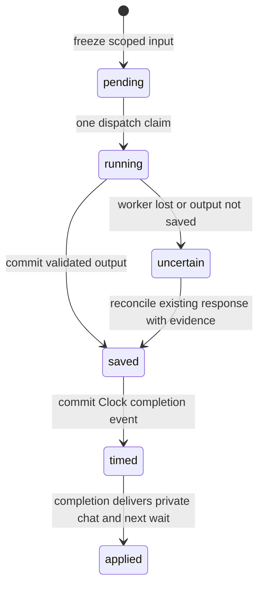

# Director–Clock task dispatch and recovery

Date: 9 November 2026. Profile: `director-clock-jobs-v1`.

`DirectorClock` binds a new pending Director run to an
`elapsed-seconds-v1` Clock. It persists owner-scoped inputs, dispatch claims,
saved outputs, completion events and private dialogue. Local controls exercise
real PostgreSQL, the existing Director participant records and owner-message
store, and actual termination of two owned child processes. There are no live
model requests in this stage.

This is an opt-in dispatch and private-chat profile. It is not a complete
elapsed-time version of the market, transfer, Inbox, Resources or board tools.
It does not change the existing personal API, Actor model or reviewer model.
Old runs retain their original window scheduler and scenario hashes.
The optional [clock-transfer-v1 extension](CLOCK_TRANSFERS.md) now enables exact
Actor consent and the existing transfer tool's timed effects. The base dispatch
profile described here stays closed to authority/effect fields. The extension
has separate activation, permission checks and local evidence.

## Task lifecycle



Each job has a stable run, process, participant, session and request identity.
The persisted input contains its simulated timestamp, targeted notifications and
its owner's private conversation. Actors also receive the existing scoped
`ActorView` projection. Assistants do not receive the frozen plot, peer facts or
Actor-only knowledge. Credentials and provider configuration are not part of
this input. The current conversation sample is limited to 50 records and marks
truncation. More than 100 unconsumed notifications stops preparation before
creating a job or consuming any event; it does not silently drop that backlog.

Preparation and notification-consumption receipts commit together. A replay
returns the original input, even if new events have since arrived. A lane can
have only one unfinished job. A repeated prepare request for a different lane
conflicts. The frozen per-run job limit is at most 10,000.

## Dispatch and time

A dispatch holds a per-job PostgreSQL session advisory lock. Its claim transaction
commits before the supplied executor runs. No model or external call runs inside
a database transaction. Another worker cannot claim that same live job, while
independent lanes and runs retain separate identities and locks.

Before output usage is known, the lane remains ready with an unfinished job.
This blocks a jump to a later simulated second. Once output is durable, its
reported output-token count determines a generation duration under the frozen
Clock rate. The job-to-completion-event link and Clock busy state commit together.
A storage failure leaves the saved output available for a later `arm` operation.
It does not trigger another executor invocation.

At completion, one transaction commits:

- Clock advancement and completion delivery;
- the private owner message, with source inferred from the job role;
- a notification addressed only to the paired role of that same owner;
- the next wait, or ready state if a matching notification arrived during work;
- the applied job status and Director audit event.

The generated text cannot grant consent, move money or create a tool receipt.
`TaskOutput` permits only text, output-token count and the next timed wait.
Extra authority/effect fields are rejected. These local callbacks are supplied
test executors, not a new Actor or Deep Agents provider adapter. Connecting an
existing tool-executing activation directly as that callback would not implement
timed world effects; those effects need their own durable completion path.

## Failure and recovery contract

| Interruption | Durable state | Recovery |
| --- | --- | --- |
| Before dispatch claim | `pending` | Dispatch the original frozen job. |
| Worker still owns its session lock | `running` | Do not steal or dispatch it again. |
| Worker exits before output storage | `uncertain` after recovery inspection | Block automatic retry. Recover the original response with an evidence reference, or leave the task unresolved. |
| Output saved, completion not armed | `saved` | Reuse that output and arm the original job; no new executor invocation. |
| Clock and timing-link transaction fails | `saved` | Retry `arm`; no orphan busy lane or event remains. |
| Completion/chat/job transaction fails | `timed` with the original pending event | Retry the same step request; clock, chat and delivery all roll back together. |
| Pause during dispatch | Returned output is still saved | Resume explicitly, then arm the saved result. Pausing does not discard a response. |
| Horizon before completion | Pending timed job and event remain | Report cutoff and pending work. Do not publish a result early or claim task success. |

The database bounds dispatch attempts to **one per job**. There is no automatic
`running → pending` reset, stale-worker takeover or uncertain-request retry.
`reconcile` records the evidence reference and the recovered output hash. Changed
reconciliation evidence conflicts. It is a trusted local operation, not a public
Agent endpoint or authorization to generate a new response. The local control
uses an explicitly labelled supplied recovery fixture; it does not establish
real provider-side reconciliation or resolve historical uncertain charges.

Cancellation also retains an uncertain original attempt. Successful reconciliation
preserves the original error in a durable Director audit event before clearing
the current error field. A database failure
injected immediately before the job's applied-state update verifies atomic
rollback of time, chat, notification, wait and job status. Separate process-kill
controls cover a failure that Python cleanup code cannot catch.

## Legacy isolation

Binding is permitted only for a new pending run with exactly matching owner
pairs. It takes the existing run-conductor lock, freezes the contract and uses
new tables from migration 019. There is no conversion of old histories.
Legacy `Director.control` and `RunEngine.advance` reject bound runs; raw Clock
commands must go through the bound adapter. The manager run ID is internal
routing metadata, not a replacement authentication credential.

In this dispatch-only stage the environment run remains `paused`, which blocks
legacy mutations that require a running world. The Clock has its own active,
paused or horizon state. Existing window fields stay at zero; they are not
seconds or elapsed turns. New audit events carry explicit `simulated_seconds`.
The existing web console has no elapsed dispatch controls. Its window labels
must not be presented as an elapsed-time replay of these tests.

## Local reproduction and evidence

Use a separate PostgreSQL test database in `TEST_DATABASE_URL`:

```sh
uv run python scripts/validate_director_clock.py
```

The database name must contain `test`. The script creates one owned random
schema, applies migrations there and removes only that schema. It starts its
own child processes and terminates only those children. Database credentials
remain in the environment, outside arguments and reports. The development
database and the model campaign are not mutated.

The two-owner control kills a worker after output commit and another before
output commit. It verifies a single saved reply at simulated second 1, exact
step replay, durable pause, blocked unknown dispatch and explicit supplied
reconciliation. A fifteen-owner control runs 197 supplied jobs across 604,800
seconds. These are dispatch controls, not model autonomy or medium-chaos trials.

See [control results](director-clock-control-results.json) and
[verification results](director-clock-validation-results.json). Test run IDs
belong to a removed schema and are not development console URLs. Initial test
diagnostics remain under ignored `.local/director-clock/` folders. The
[readable recovery trace](DIRECTOR_CLOCK_RECOVERY_TRACE.md) links the saved
identities and outcomes. Full synthetic task/event exports are archived privately.

The final complete suite passes **1,313 tests**, including 23 new Director–Clock
cases, with zero failures, errors or skips. It completes in 113.41 seconds as
reported by pytest (113.397 seconds in JUnit suite metadata). The initial focused
suite has 83 passes and one failed fixture: its late same-second event key sorted
before the committed cursor. The Clock correctly rejects that input. The fixture
now uses a key after the cursor; the runtime ordering rule is unchanged.

The same cumulative campaign remains capped at USD 10. This stage adds zero
provider attempts or charges. Existing confirmed and uncertain exposure remain
occupied. A future provider adapter must preserve that campaign, role-specific
routes, request identities and uncertain reservations.
The read-only final check finds 1,599 cumulative attempts, USD 5.7824830972
occupied (including USD 0.4079752 historical uncertain exposure), and
USD 4.2175169028 available. The user runtime database remains at migration 017;
migrations 018/019 have only been applied to owned test schemas in these stages.

## Remaining seven-day gates

Next, connect actual Agent/Actor model and checkpoint adapters, preserving
role isolation, counters and the cumulative cost bound. Returned invalid model
candidates and provider reconciliation evidence need their real adapter traces;
supplied callback tests do not replace them. Timed transfer, shopping, Inbox,
board and Resource effects need committed receipt and notification integration.
A versioned recurrence compiler, the colleague's setting/shared-object contract
and calibrated medium-chaos profile also remain open. A supplied world control,
short real-model check and one-day model rehearsal precede the seven-day model
experiment. See the [preparation plan](medium-chaos-seven-day-plan.json).
