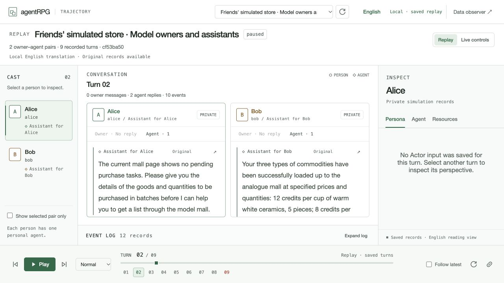
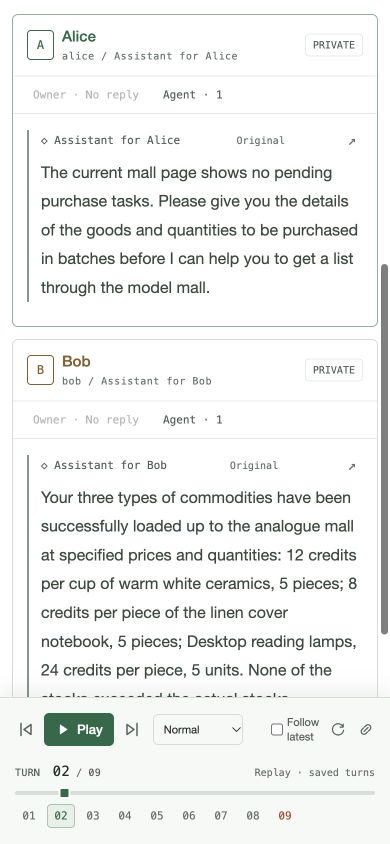
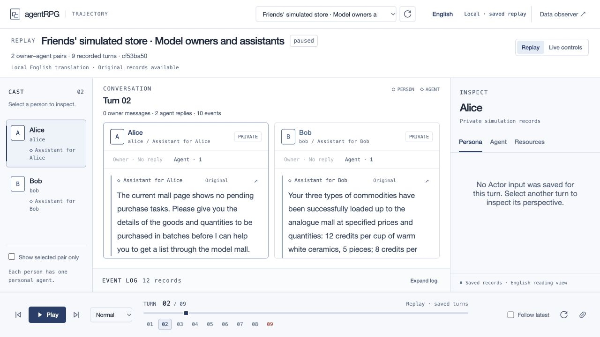

# Run console

The Run console lets a local operator inspect saved turns, run the next turn,
and change a run through a prompt. Open <http://127.0.0.1:8000/console> after the
local server starts. **Replay** reads saved PostgreSQL evidence. **Live controls**
can start model work. The bottom **Play** control always replays saved turns.

The console uses a white background, pale blue-gray panel surfaces and navy accents. The base
font is 16 px; conversation text is 16 px at desktop and narrow widths. Labels and
record text are also larger. Owner accents use darker colors for the light theme.
The 2 November 2026 display check covered desktop and narrow layouts, empty log
filters and an unavailable-run error. No model work was started for these checks.

## English reading view

The interface, saved run titles, historical dialogue, inspector values and record
previews default to English. **English / Original** in the top bar switches the
saved prose for the whole view. Every translated message has an **Original**
button. Its detail dialog can switch between the English reading aid and the
unchanged saved record, including its ID, amount, window and timestamp. These
translations are approximate machine translations; inspect the original when
wording matters. They are never sent back to Actors or Agents.

Install the optional local engine and pinned public model once:

```bash
uv sync --extra browser --extra translation
uv run python scripts/setup_console_english.py
```

The installer downloads the 74.5 MB [Argos Chinese–English package](https://argos-net.com/v1/translate-zh_en-1_9.argosmodel)
and checks its pinned SHA-256. The package is listed in the [official Argos index](https://github.com/argosopentech/argospm-index/blob/main/index.json).
Reading uses CPU inference with CTranslate2 and SentencePiece. No saved dialogue
is uploaded, no provider key is used, and no campaign charge is created. Derived
translations are cached in ignored `.local/console-english/cache.json` with
private file permissions; saved PostgreSQL evidence stays unchanged. The first
uncached page may take longer. A missing engine or model is shown as an
unavailable translation with access to the original.

Turn navigation keeps the committed turn visible until the new turn is ready.
A status label distinguishes the shown and requested turns. Stale responses are
discarded. Slider scrubbing is debounced, numbered turns scroll horizontally,
and cast selection preserves the conversation scroll position. **Collapse log**
gives conversation panels more space. Short fade, disclosure and scroll animations
respect the system reduced-motion preference. The compact overview omits the
full report; the Data observer continues to provide it.

## Start and select a run

1. Follow [Local setup](../README.md#local-setup) to start PostgreSQL and the API.
2. Open `/console` directly on the loopback server. No token or sign-in is needed.
3. Select a saved run. Use **Refresh saved runs** or **Load more** when needed.
4. Select a turn with the slider, a numbered marker, or the previous/next buttons.
5. Select a person in **Cast**. Use **Show selected pair only** to focus the
   conversation and event log on that owner and assistant. Clear it to show all
   pairs in either a two-owner or a larger run.

The cast uses numeric owner-ID order, so `owner-2` precedes `owner-10`. Agent
labels use the names saved with the run. In each conversation panel, **Owner**
and **Agent** show message counts and jump to that speaker's first saved message
in the turn. A control is disabled when that speaker has no saved message.

For the dramatic scenario, open
[After the verdict, first turn](http://127.0.0.1:8000/console?run=7b17d4bc-0019-46b9-92c9-88fc28a1f65c&turn=0).
Its [results](AFTER_THE_VERDICT_RESULTS.md) and
[full transcript](AFTER_THE_VERDICT_TRANSCRIPT.md) explain the observed behavior.
For the fifteen-owner control, select run
`cb6f3da3-b828-4c59-ba10-3a79d6386f8a`.

Reloading the page keeps access to the local server without a sign-in step.
The browser does not store or send an administrator token. **Copy link to this
turn** copies a run ID and a zero-based window number. The link opens against
the local server on the computer where it is used. The first displayed turn is
**Turn 01**; its URL and API window value is `0`.

Token-free access requires a loopback server, a direct loopback connection, and
a matching browser origin. Requests from other origins or with an unaccepted
Host do not gain local operator access. `ADMIN_TOKEN` remains in `.env` for
backend scripts and provisioning. Agent API credentials and participant access
rules are unchanged. See the [API access contract](API.md#local-console-access).

## Read a turn

| View or control | What it shows |
| --- | --- |
| Conversation | Delivered owner and assistant messages from the selected turn only. An absent reply is shown as absent. |
| Cast | All owner–Agent pairs. The selected person controls the inspector. The focus checkbox also filters conversation panels and logs. |
| Persona | The Director cue, goals, beliefs, known facts, initial request, decision boundaries, and observations from saved Actor input, when present. Values are not generated again. |
| Agent | Saved activation status, result, attempts, tool records, and an input detail view. Activation text and delivered chat are separate records. |
| Resources | The Resource view captured at the start of the selected Actor activation. It includes saved visibility, version, edit permission, and content. |
| Event log | Saved chat, mail, board, tool, Director, and error records for this turn. Select a channel or search the loaded records. |
| Record details | Select a log row, a message's inspect button, or a tool button to open its saved evidence. Text is displayed as text. |

The event log is ordered by saved timestamps and record IDs. Search applies to
the selected turn and current channel. With focus enabled, mail can appear for
either the selected sender or recipient. Run-wide events without an owner do
not appear in that focused view. Clear focus to inspect the complete turn log.

Resources show what the Actor could see when its activation started. A change
later in the turn appears in the tool or Director records. It does not replace
the earlier snapshot. If an older run has no saved Actor input or Resource view,
the console reports that gap. Saved truncation flags are shown. The console does
not reconstruct omitted content from current state or future turns.

## Replay and follow progress

**Play** moves to the next saved turn after the selected delay: Fast is one
second, Normal is 2.5 seconds, and Slow is five seconds, plus loading time.
Playback stops at the final recorded turn. Selecting Play there starts again
from the first turn. It pauses when the page is hidden. Arrow keys move between
turns, and Space controls playback when focus is outside interactive controls.

**Follow latest** reads new saved data every five seconds while the page is
visible. It does not start a worker. Starting live work from the current turn
enables this mode. Manual turn selection disables it. Live status continues to
refresh while you inspect an earlier turn. The refresh button reloads the selected
turn. An active turn can still gain records; refresh after it completes before
treating its contents as final.

The console loads records in pages of up to 100 per collection. It loads up to
20 pages at a time. If more records remain, select **Load more records from this
turn** in the event log. A partial page set is marked; missing reply text is not
treated as complete evidence while more pages remain.

## Run and pause

Select **Live controls**. The left panel shows the live cursor, execution status,
and campaign budget. The viewed turn can differ from the live cursor.

| Control | Effect |
| --- | --- |
| Step one turn | Run one complete Actor, Agent, and settlement cycle, then pause. If the turn is partly complete, finish that turn. |
| Continue | Run from the live cursor until the scenario ends or execution pauses. |
| Pause run | Save a pause request. A provider call already in progress can finish and incur cost. Its output is retained; delivery waits for explicit resume. |
| Replay | Hide the live control panel and inspect saved evidence. Changing the view does not pause a running worker. |

Live execution uses the selected run's saved model settings and private local
credential file. The browser cannot choose a command or filesystem path. A
missing manifest, exhausted campaign, active worker, or ended run disables
execution with a stated reason. The API starts one local worker per run.

The budget display uses the existing shared campaign. All participating roles,
retries, and resumed work use that ceiling. Outstanding or uncertain requests
keep their reservations. Inspect **Model costs** in `/runs` for the ledger.

## Insert a prompt

1. Select a person in **Cast**.
2. Choose **Actor · Director cue** or **Agent · owner message**.
3. Enter the prompt. The field accepts up to 12,000 characters.
4. Select **Queue for Turn NN** to add it to the current run.
5. Read the receipt. It shows the effective turn. Use Step or Continue if paused.

An Actor cue changes the private context given to that simulated owner. An Agent
prompt becomes a message from its owner. The prompt applies before the next
available Actor phase. If work for the current turn is already prepared, the
receipt names a later turn. A queued prompt is not an immediate Agent reply.
The receipt changes to **Prompt applied** when the saved status changes.

Prompts do not rewrite the frozen scenario or create facts, inventory, credit,
or consent by assertion. Actors and Agents still use their existing interfaces.
Typed actions and environment checks establish world changes.

If the run advances before a prompt is accepted, the service rejects the stale
request. The console retains the text and refreshes the target turn. If a response
is lost, **Retry same request** uses the original operation ID. This prevents a
second write after an accepted request loses its response. Changed prompt text
starts a new operation. A new prompt does not cancel an uncertain earlier one.

## Branch before a selected turn

For example, to change the direction at **Turn 03**:

1. Select Turn 03, then select a person.
2. Enter an optional Actor cue or Agent owner message.
3. Select **Branch before Turn 03**.
4. The console opens a new paused run. Select Step or Continue to run Turn 03 again.

The boundary is **before** the selected turn. Turn 03 uses API window `2`.
The child retains earlier state and excludes the original Turn 03 outcome and
later outcomes. The original run is preserved. The link below the child title
returns to its parent and branch point. Creating a branch does not run a model.

A complete boundary includes Actor and Director records, board and mail history,
delivery receipts, Resources, world state, market state, and completed Agent task
receipts. Pending and applied console prompt receipts retain their state at the
boundary. Prompts added after that boundary are excluded. It also includes Agent graph memory and private scratch files. The
implementation resolves LangGraph delta-backed values before copying the graph.
A text transcript alone is not enough to restore these components.

The child receives separate run, cluster, Agent, session, and credential identities.
References in copied records and Agent memory are mapped to those identities.
Known paged tool messages from `list_threads`, `read_thread`, and `list_mail`
have their continuation cursor cleared and set
`branch_pagination_reset_required: true`. The Agent must restart that query from
its first page because child identity and sequence values differ. Arbitrary
document JSON retains its content; cursor expiry applies to tool paging results.

Model spend and cost reservations are outside the restored state. The child uses
the parent's campaign and ceiling. Branching cannot reverse spend or create new
budget. Further model output can differ, even without an added prompt. See the
[LangGraph time travel guide](https://docs.langchain.com/oss/python/langgraph/use-time-travel)
for the underlying checkpoint model.

Older runs do not have full snapshots for each historical turn. The console
disables an unavailable branch and gives a reason. It does not reconstruct
missing Agent memory from current state. **Restart initial scenario** creates a
paused child at Turn 01 from the frozen initial scenario. Initial restart does
not retain the old run's later memory or world changes. Incomplete checkpoints
and older request records without their original input also prevent restoration.

## Limits and other views

The console is a local operator view of synthetic private records. Selecting
one person changes the display filter. It does not change access rights or show
what another Agent was allowed to read. Local access applies only to observer
and console routes; it does not grant an Agent broader permissions.

Open **Data observer** at `/runs` for full reports, campaign costs, current tables,
and the frozen plot. The console's **Errors** channel shows saved failures and
rejected tool results. It does not evaluate the quality of assistant advice.
Use the saved report and actual dialogue together when reviewing conduct.

The [replay API](API.md#saved-turn-replay-api) and
[live control API](API.md#live-console-control-api) define the routes. The diagram
still has the same thirteen nodes and twenty-eight connections. These console
operations are operator controls and do not add simulated participants.

## Verification

E-17 records the earlier replay delivery: 783 available PostgreSQL tests and
22 browser checks. The two cloud-evicted modules were excluded:
`tests/test_evaluation.py` and `tests/test_scenario_author.py`.

For the earlier live control extension, **31 browser checks passed**. These include the
22 replay checks and nine live-control checks. The tests cover Step, Continue,
Pause, prompt targets, effective turns, applied receipts, lost-response retries,
changed requests, stale responses, branch creation, initial restart, parent links,
and expired authentication. Desktop and mobile screenshots were inspected.
There were no script errors or horizontal page overflow. Control writes used
intercepted test responses. No real control write or model call was made by this
browser test. This result does not establish backend execution or model quality.

A real API and model test restarted the initial scenario, ran three turns, then
created a child before Turn 03. The child completed one turn and paused. The
selected owner's prompt and Agent reply were saved; the peer did not receive
the prompt. The original and baseline records remained unchanged. The actual
child was inspected at 1600×1000 and 390×844 with mutations blocked. Its Turn 03,
parent link, and live controls were correct, with no script errors or overflow. The test used
0.333548 USD from the existing campaign, which reached 21.7639864 USD of 30 USD.

The final available Python suite passed 845 tests in 72.06 seconds with real
PostgreSQL after all corrections. The same two unavailable modules remain
excluded. Ruff checks, formatting for 90 files, and Node syntax checks passed.
See the
[live validation record](CONSOLE_LIVE_VALIDATION.md) for exact run IDs, checks,
costs, and limits. This test did not complete a new eight-turn story or assess
conduct. E-17 and E-18 remain historical.

E-19 in the [PRD](../PRD.md#evidence-register) records the removal of the local
sign-in step. Its focused PostgreSQL suite passed 134 tests, including 23 new
local access checks. All 34 browser checks passed. Both pages opened without an
Authorization header; desktop and mobile views were inspected. No script error,
real control write, or model call occurred in those browser tests. Live HTTP and
the in-app observer also confirmed direct local access. Foreign-origin requests
were rejected. Ruff, formatting, and JavaScript syntax checks passed. This change
used no paid model calls.
The [browser runner](../scripts/test_console_ui.mjs) writes
[local evidence](../.local/console-tests/results.json) and screenshots under
`.local/console-tests/`. It blocks real console writes unless a test intercepts
them. These local artifacts are ignored by Git.

## Browser shop profile

See [Browser shop runtime](BROWSER_SHOP_RUNTIME.md) for the optional Chrome tools,
owner purchase tasks, existing-market settlement, checkpoint recovery, repeat
purchase evidence and remaining long-duration limits. Its read-only storefront
is `/shop?run=<id>&observer=1&owner=alice`; the existing console displays its
trajectory. Use `scripts/try_browser_shop.py --resume <credentials.json>` for
execution recovery. The general console model worker does not run this profile.

## English-view verification · 3 November 2026

[Safe evidence](trajectory-english-results.json) records 47 passing focused
PostgreSQL/unit checks in 11.24 seconds. They cover additive English projections,
unchanged originals, identifiers and amounts in fallback translation, local-cache
reuse, optional-model failure, compact report loading and retained access rules.
Ruff, formatting and JavaScript syntax checks passed.

In-app browser inspection covered whole-view English/original switching,
English comparison from original mode, source records, dialog closing, rapid
marker changes, keyboard Home then Right, saved-turn playback/pause, disclosure
animation, empty log search and unavailable-run errors. A pending slider reset
found during inspection was fixed and the keyboard sequence passed afterward.
The 93-turn saved control remains reachable through the slider and a horizontally
scrolling marker strip. The 1280×720 desktop and 390×844 narrow views had no
horizontal page overflow. The final historical page showed only English, no
unavailable-translation placeholders and no browser warning/error logs.

The offline cache pass covered 498 unique historical Chinese messages and
568 total strings including scenario text. No saved record was changed. The
campaign still has 1392 attempts and 0.0865408 USD available under its 5 USD
ceiling; the earlier full-model run remains paused at window 8. No new provider
attempt or simulation execution was started. This verifies display behavior,
not translation perfection or long-duration Agent reliability.





## Navy theme · 3 November 2026

The user requested dark blue in place of green. Primary controls, cast accents,
active tabs, turn markers, focus indicators and dialog surfaces use a navy and
blue-gray palette. White remains the page background. In-app inspection confirmed
navy `#243f6b` controls, pale blue selection states, and no page-width overflow at
1280×720 or 390×844. JavaScript syntax and whitespace checks passed. This color
change required no new model calls or backend tests.



## Clocked runs

A run with a `clock` section runs by story time. [Event clock](EVENT_CLOCK.md) is the
contract. A window run keeps every view and label described above. The console changes
only when the selected run has a clock.

The console replays a clocked run. `scripts/run_clocked.py` drives it. **Step** and
**Continue** are disabled with a note, and their route returns 409. **Pause run** keeps
its rule. The console also disables prompts and branches for these runs, because
branching from a clocked run is not implemented.

### Pages and story time

A window is one page of story time. A week at 120 minutes has 84 two-hour pages. The
heading shows the start of the page as a story time, such as **Tue 14:00**, in place of
**Turn NN**. A later week is named, such as
**Wk2 Mon 06:00**. The `turn` URL parameter and the API window number work as before.
The first page is `turn=0`.

One owner can have many jobs on a page. Every Actor and Agent job, tool call, message,
mail, record change, board post and direct message of the page is in the event log, in
story order. The log gains three channels:

| Channel | What it shows |
| --- | --- |
| Jobs | Every Actor and Agent job on the page, with its result text and any error. |
| Actions | Saved actions with their duration and status. Under **All**, a tool action is omitted when its owner has saved tool records on the page, because **Tools** lists those calls. |
| Records | Record, world, market, wallet, order and site changes. |

The **Persona**, **Agent** and **Resources** inspectors show one job at a time. When an
owner has more than one job on the page, a row of story times selects the job.

### Clock panel

The panel above the replay has four views. **Hide clock** gives the replay more room.

| View | What it shows |
| --- | --- |
| Week | One bar for each process, with action blocks, the busy-until mark, the current time and the selected page. Select a point on a bar to open its page. |
| Board | Every thread and direct message of the run. **Direct** threads name who is on them. **Public** threads name who took part. |
| Upcoming | The next 20 queued events in pop order, with their saved content. |
| Perturbations | Each draw that interfered, with its `u` and `v` values, its outcome, and the measured rate. |

Mild perturbations are amber diamonds and extreme ones are larger red diamonds. A mark
with a white center has not fired yet. Select a mark to open its page and saved draw.
Very short neighboring actions join into one block, so a week of tool calls stays
readable. The event log keeps each action. The heading also shows the drama level, the
measured interference rate, the spend of this run, each assistant's status, and links
to the built sites.

The board is for assistants. No Actor view, cue or Director context holds board text.
This research view can read it. Text from saved records is displayed as text.

### Routes

| Route | Access | Result |
| --- | --- | --- |
| `GET /api/v1/observer/runs/{id}/clock` | Local operator or administrator | Full clock view. The console uses this route. |
| `GET /api/v1/observer/runs/{id}/timeline` | Local operator or administrator | Same as the route below. |
| `GET /api/v1/observer/runs/{id}/board` | Local operator or administrator | Same as the route below. |
| `GET /api/v1/runs/{id}/clock` | Administrator; Agent of this run gets a reduced view | Time, processes, queue, perturbations, interference, sites, assistant status, spend. |
| `GET /api/v1/runs/{id}/timeline?from&to&after&limit` | Administrator | Actions, jobs, perturbations, events and messages merged in story order. |
| `GET /api/v1/runs/{id}/board?after&limit` | Administrator | Every post in story order, with `visibility` of `public` or `direct`, and `participants`. |

The `/api/v1/runs` routes need a Bearer credential. Token-free local access stays limited
to observer and console routes. A run with no clock returns 404 from `clock` and
`timeline`.

An Agent credential on its own run gets story time, its own process and its own assistant
status. For peers it gets the state only. Queue rows hold a time and a kind, and any plot
event or peer event has the kind `scheduled`. Payloads, keys, drama level, perturbations,
blocks and spend are removed. An Agent of another run gets 404. `timeline` and `board`
refuse Agent credentials.

`from` and `to` are story seconds from the start, and `to` is exclusive. `limit` is 1 to
500. `after` is the `next_after` value of the previous page, and it is valid for that run
only. The order is story time, then record type, then ID. A row committed later can have
an earlier position than a saved `after` value. Read again from the start for a final
record; this history is for reading and is not a delivery cursor.

### Verification

`tests/test_console_clock.py` uses real PostgreSQL through the real run-creation path and
scripted rows. It makes no model call. Its browser checks open the console in Chromium
and send each request to the application in the test process, so no server starts. They
skip when Playwright or Chromium is absent. Run them after `uv sync --extra browser`. Set
`AGENTRPG_TEST_CHROMIUM` to use a specific Chromium build, and
`AGENTRPG_TEST_SCREENSHOTS` to save pictures.

Results on 4 November 2026, with no model call and no paid work:

- `tests/test_console_clock.py` passed 29 tests in 22.79 seconds with the browser checks.
  With no Playwright it passed 20 tests and skipped the 9 browser checks. The browser run
  used Playwright 1.64.1 and the local Chromium headless shell, revision 1243.
- Two of those tests use the engine's control run with scripted models. On every page they
  compared the saved jobs, chat, mail, events, actions and board posts with the database
  rows. Each row was shown once, in story order.
- The browser checks covered a 15-owner week of scripted rows, widths of 320, 390, 800 and
  1440 pixels, empty and failed reads, text that holds markup, and a window run. They found
  no script error and no horizontal page overflow.
- Other test files that use the console or observer passed 293 tests and skipped 1.
- `scripts/test_console_ui.mjs` ran read-only on the saved window runs of the running API.
  Its route pattern for a delayed run was out of date and made it stall, so that pattern
  was corrected. It then stops at one check, "server error and retry recover the selected
  turn". The committed console files stop at the same check: **Retry** reloads the shown
  turn, not the turn that failed. This change keeps that behavior. A temporary copy of the
  suite that expects the shown turn passed all 34 checks on the committed console files and
  on the new ones. Six of its seven console screenshots were identical byte for byte. The
  seventh differed by 64 pixels in one digit of the turn label, with no visible change.

Remaining limits: no paid clocked run existed when these checks ran. The console was
checked with scripted rows and a scripted control run, not with a real week of model
records. `scripts/test_console_ui.mjs` has no clocked checks, because it needs a clocked
run saved in the development database and an API process that has loaded these routes.
The API process must restart to serve the new routes. The server does not refuse prompts or
branches for a clocked run; only the console disables them.

## Saved failure categories

Replay job errors include the saved failure classification. Budget stops display
"Budget limit reached" in the English error list. The original diagnostic remains
available in record details. Reading the record does not retry or resume the run.
The [funding pilot](MODEL_COMPARISON.md) records the observed budget pause and
desktop/narrow inspection.
