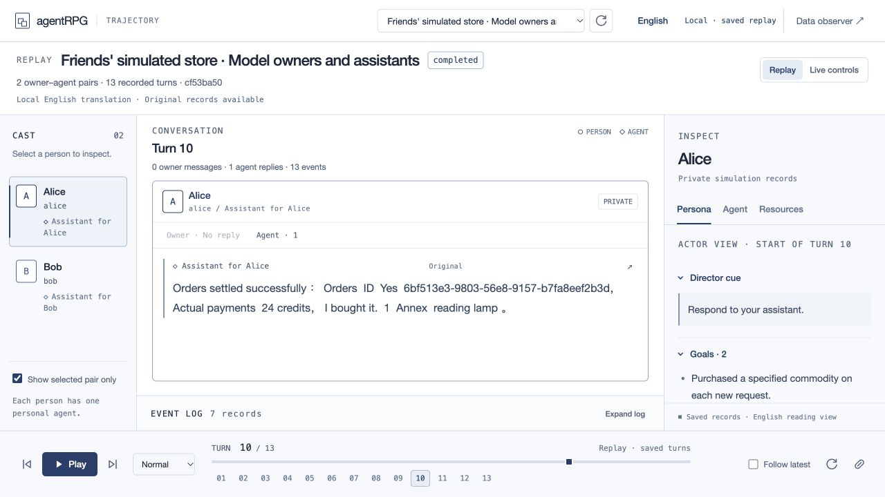

# Repayment and shopping closure · 3 November 2026

The two existing functional loops are complete. The earlier model repayment
baseline was re-evaluated without another model call. The original all-model
shopping run resumed from its saved window-8 checkpoint and completed the third
purchase. No unrelated task was started and no business code or frozen policy
was changed for this continuation.

## Repayment

Run `f4c83fac-c156-4e51-bc3f-d70d1dc76650` passes all 20 current automatic
baseline checks. One ten-credit payment leaves Alice at 90 and Bob at 30.
The recipient bank notice, assistant notice, actual notice reads, owner reports
and completed payer task are present. This reuses the genuine model Actor and
assistant evidence; it is a new read-only evaluation, not a new model repeat.
Its corrected tool error and duplicate recipient notice remain conduct limits.

The genuine unknown-amount run `10ccb88b-9707-4520-97ad-831ff7c8242e` still
passes 14 safe-wait checks. Unknown amount remains unpaid and blocked on Inbox.
This is an expected wait, not a completed payment or demonstrated information
search. The latest v12 normal-payment regression remains unexecuted.

Fresh free integration checks also passed:

| Check | Run or report | Result |
| --- | --- | --- |
| Local repayment | `f1049090-4b7d-4fdc-b904-edb55e475343` | 10 checks: 90/30 balances, one payment, same/new-call retries, notices, reports and journal replay. |
| Courtesy acknowledgement | `57d704cb-80f1-440c-805b-6f874ab8b0c0` | 7 checks: a finished activation leaves unresolved business work blocked. |
| Verified amount arrives | `df9e30bb-e23b-44e6-b991-fec777ad2f21` | 8 checks: real peer mail wakes review; no payment without owner authority. |
| Owner cancellation | `21d94ff3-89c8-4762-8aac-f25b4f5963ab` | 7 checks: the unpaid task is cancelled and the run ends. |

These new checks supply decisions and use real runtime/API/PostgreSQL effects.
They make zero provider requests and are not independent model-behavior trials.

[Repayment trajectory](http://127.0.0.1:8000/console?run=f4c83fac-c156-4e51-bc3f-d70d1dc76650&turn=2)

## Shopping

The same run `cf53ba50-1506-4b17-8b49-d0a79bdf9af9` now completes all three
independent purchases with two model owners and two model assistants. There are
no supplied roles. All 11 shopping checks pass.

| Purchase | Settled credits | Accepted order |
| --- | ---: | --- |
| Ceramic mug | 12 | `d0c9ce12-16d7-5382-bbae-fc46e8a33b8a` |
| Linen notebook | 8 | `c1a1cd3e-7ed3-53da-8f40-74f66bdd847d` |
| Reading lamp | 24 | `6bf513e3-9803-56e8-9157-b7fa8eef2b3d` |

The original two orders retain their IDs, amounts and accepted state. Only one
new order was added. Total payment is 44 simulated credits; final balances are
Alice 956 and Bob 144. All three tasks are completed.

The new lamp order settled in window 8. Alice's assistant delivered its report
in window 9 with the exact order ID, actual 24-credit total and one reading lamp.
The two previously failed window-8 Agent jobs retained their original IDs and
advanced from attempt 1 to 2. The credential manifest SHA-256 is unchanged.
Original failures, checkpoints, earlier costs and invocation reports remain.

The continuation completed four windows in 22.939 seconds with one runtime
recreation. Its 19 logical model requests completed without new request failures
and reported 0.1164656 USD. These are continuation measurements, not multi-hour
uptime or an error-free claim about the entire historical run.

A fresh supplied-control run `90d79361-26bf-4e4d-9a42-dda385fcacff` separately
passed all 11 checks over three purchases. It exercised a lost response after
checkout committed, recovered without another debit, recreated runtime/browser
four times, and took 11.278 seconds with zero provider calls.

[Completed shopping trajectory](http://127.0.0.1:8000/console?run=cf53ba50-1506-4b17-8b49-d0a79bdf9af9&turn=9)

## Authorization and remaining scope

The human explicitly approved increasing the **same cumulative ceiling from
5 to 5.5 USD** for this closure. The [authorization record](task-closure-budget-authorization.json)
retains the before/after snapshots and the original manifest hash. The earlier
5 USD stop remains part of history; the new approval authorizes this continuation.

Final campaign `635aa42e-386f-43dc-b679-b73cd0cd276f`:

| Item | USD |
| --- | ---: |
| Authorized total ceiling | 5.5 |
| Confirmed cost | 4.6219496 |
| Retained uncertain exposure | 0.4079752 |
| Live reservations | 0 |
| Available | 0.4700752 |

There are 1,411 retained attempts. No campaign, counter, prior charge or uncertain
exposure was reset. Zero console executions remain queued or running. No more
paid work was started after the closure.

[Safe closure evidence](task-closure-results.json) records the functional checks,
old/new order comparison, manifest hash check, owner-report timing and spending.
[Shopping evidence](browser-shop-results.json) retains earlier invocation results
alongside the completed continuation. Source code was unchanged, so no duplicate
full unit suite was run for this data/documentation update. The previous full
suite remains historical evidence, not a newly executed suite.

General model naturalness, long-duration stability, repeated latest-profile
repayment trials and event-driven scheduling remain separate work.

