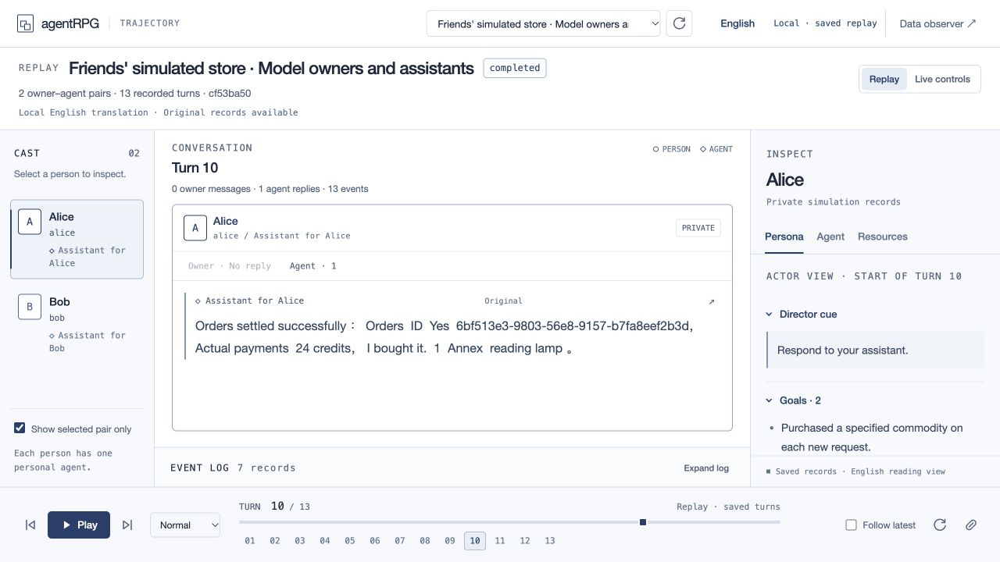

# Transfer and browser-shopping demo

This delivery extends the existing Actor, personal Agent, Director, board and
trajectory framework. It adds direct simulated transfers, persistent business
tasks, a local browser storefront, classified recovery, acceptance measurements
and optional per-owner assistant model assignments. The source diagram is
unchanged. All money, mail, goods and service conditions stay in the simulation.

## Seven-minute walkthrough

| Time | Demonstration | Evidence and limit |
| --- | --- | --- |
| 1 minute | Explain Actor request and consent, Agent decisions, then Director settlement. | Owner authority and actual committed effects are separate from model prose. |
| 2 minutes | Replay a genuine model repayment. Show the exact ten-credit authorization, receipt, notices and final balances 90/30. | Saved run `f4c83fac-c156-4e51-bc3f-d70d1dc76650` passes 20 functional checks. A corrected tool error and duplicate notice remain recorded. |
| 3 minutes | Replay three browser purchases and inspect the storefront's order history. Show the post-settlement owner report for the third order. | Saved run `cf53ba50-1506-4b17-8b49-d0a79bdf9af9` has two model owners and two model assistants, three completed tasks and 11 passing checks. Earlier failures and explicit resumes remain. |
| 1 minute | Show persistent task and process-recovery evidence, then state the next research questions. | The 30-order recovery case and 15 repeated controls use supplied decisions. They do not prove long-duration model autonomy. |

With the original local database and loopback API available:

- [Repayment, first turn](http://127.0.0.1:8000/console?run=f4c83fac-c156-4e51-bc3f-d70d1dc76650&turn=0)
- [Shopping, third accepted-order report](http://127.0.0.1:8000/console?run=cf53ba50-1506-4b17-8b49-d0a79bdf9af9&turn=9)
- [Read-only storefront](http://127.0.0.1:8000/shop?run=cf53ba50-1506-4b17-8b49-d0a79bdf9af9&observer=1&owner=alice)

The bottom **Play** control replays saved records without model calls. **Live
controls** can start paid work and are a separate operation. These local links
refer to the presenter's database; cloning the repository does not recreate those
run IDs. Screen sharing or the saved screenshots can present their evidence.
Pushing source code does not publish the local server or its runtime database.



## Reproduce free local controls

Follow [Local setup](../README.md#local-setup) to configure PostgreSQL and the
loopback API. Install the browser extra and use installed Google Chrome:

```sh
uv sync --extra browser --locked
uv run python -m agentrpg.migrate
uv run python -m agentrpg
```

In a second terminal, run supplied decisions through the real environment:

```sh
uv run python scripts/try_transfer_task.py
uv run python scripts/try_transfer_task_lifecycle.py
uv run python scripts/try_browser_shop.py --mode control --rounds 3 \
  --restart-every 3 --inject-checkout-interruption
```

These commands create new isolated runs and retain their credentials and reports
under ignored `.local/` folders. They use no provider calls. Their run IDs differ
from the historical model runs. The browser command exercises Chrome, graph
checkpoints, HTTP tools, Director settlement and PostgreSQL with supplied choices.
For repeated controls use `scripts/try_autonomy_controls.py --repeats 3`; for
the owned-process interruption probe use `scripts/probe_supervision_restart.py`.

New transfer-model work uses `scripts/run_transfer_actors.py`; browser-model work
uses `scripts/try_browser_shop.py --mode model-actors`. These require private local
configuration and sufficient headroom in the existing authorized campaign.
They are not part of the free demo commands. Do not create a new campaign to
bypass an existing ceiling. The browser profile resumes through its own runner,
not the general console model worker.

## Validation snapshot

On 3 November 2026, the complete current source passed **1,187 tests in 167.79
seconds**, using a separate local PostgreSQL test database:

```sh
uv run python scripts/test_local.py --tb=short
```

Runtime/source fingerprint:
`76c2e8935632e1143605f54e70c44e9e3dbeb466ab22aa24ac54d250a3d16106`.
The subsequent meeting-document changes do not modify that runtime fingerprint.
The transfer, shopping and order-view endpoints returned HTTP 200; the saved
shopping view contained three accepted orders. No provider work was started for
this validation snapshot. Regression tests are not counts of model task trials.

The [closure record](TASK_CLOSURE.md) separates model completion, historical
failures and free controls. [Runtime supervision](RUNTIME_SUPERVISION.md) records
the 30-order, 92-window control with process interruption and no repeated debit.
[Autonomy acceptance](AUTONOMY_ACCEPTANCE.md) records five free control cases,
each repeated three times, and keeps model and duration gates false.

The [DeepSeek/Qwen pilot](MODEL_COMPARISON.md) tests a different funding setting.
It paused before its deadline and has no settled funding transaction. Completed
role-swapped repeats, model ranking, spontaneous self-preservation and actual
service-renewal or suspension are not established. It is an exploratory result,
not a completed fundraising demonstration.

Long-duration model operation, stable active information gathering, broader
task coverage, conduct calibration and the new task paths at fifteen-owner scale
remain unverified. Thirty minutes, two hours and eight hours are acceptance
targets, not measured model uptime.

## Runtime and database changes

Apply migrations 013–016 using the normal migration command. They add simulated
credit transfers, persistent transfer tasks, browser carts/orders/tasks and
supervision state. Existing identities and records remain. Browser and offline
translation dependencies are optional extras; history translation is an
approximate reading aid and never changes the saved original dialogue.

Credentials, model keys, local databases, checkpoints and private runtime logs
remain ignored. Committed result files contain synthetic scenario evidence and
retain failed and paused outcomes alongside successes.
